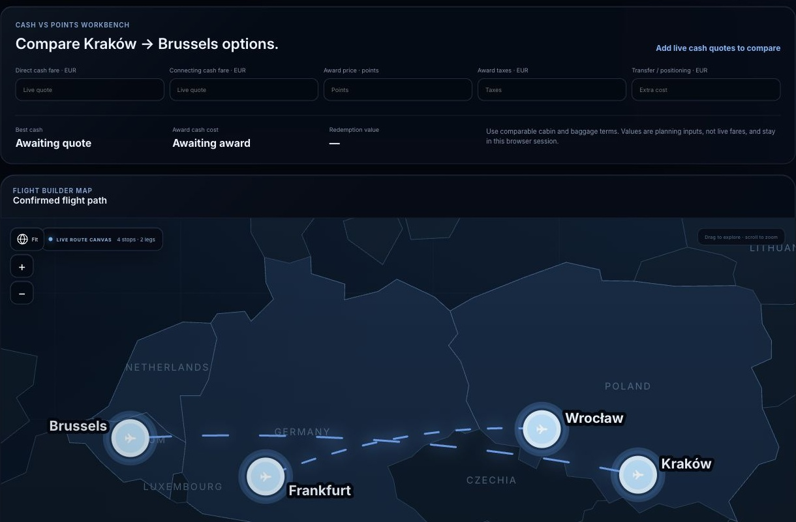
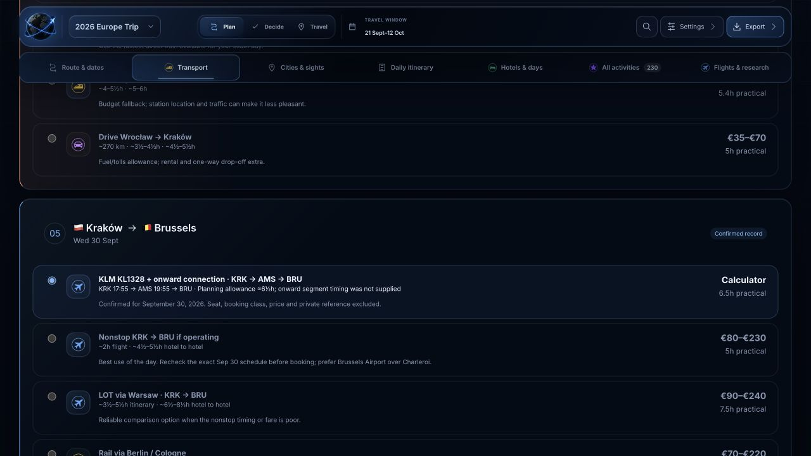
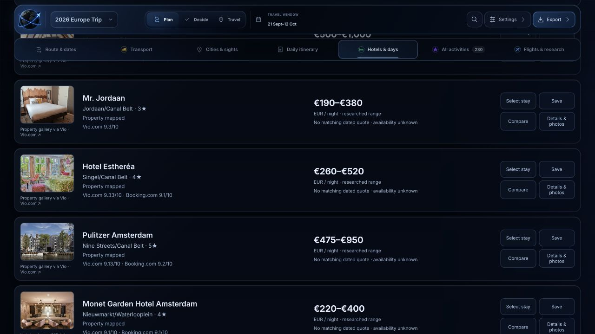
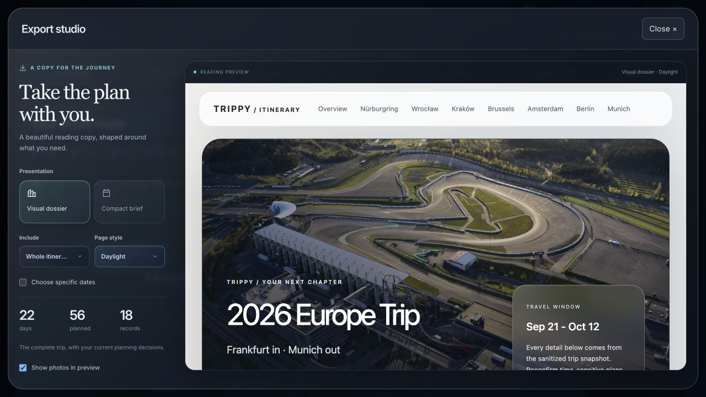
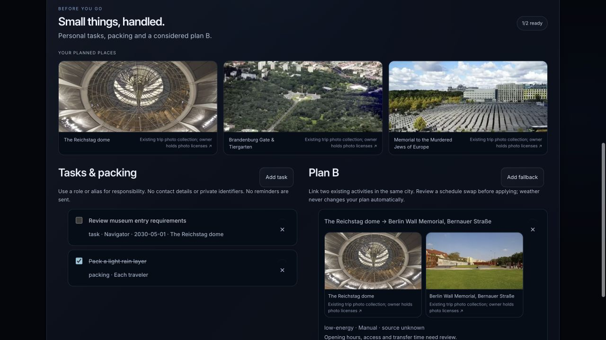
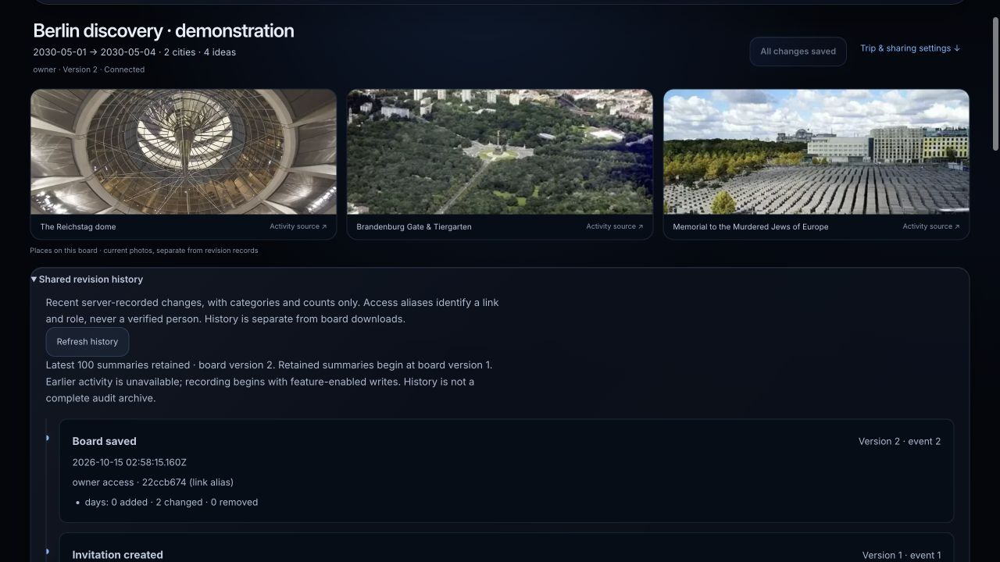
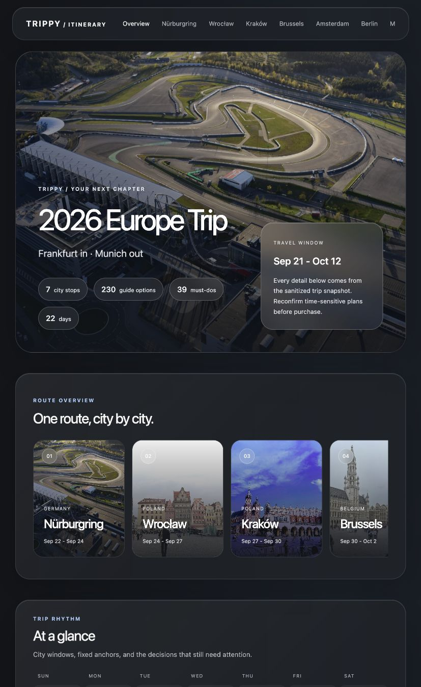

<p align="center">
  
</p>
<h1 align="center">Trippy Travel Planner</h1>
<p align="center"><strong>Find better value. Shape the whole journey. Make room for discovery.</strong></p>
<p align="center">
  <a href="#start-locally">Get started</a> ·
  <a href="prompts/START_HERE.md">Plan with an agent</a> ·
  <a href="docs/INTEGRATIONS.md">APIs & connectors</a> ·
  <a href="docs/SCREENSHOTS.md">App gallery</a> ·
  <a href="docs/BUILD_PROGRESS.md">Implementation status</a>
</p>


**Your flights, trains, stays, sights and daily decisions, connected in one workspace.** Compare cash and award assumptions, explore multi-city routes, build editable days, track booking gaps and plan with friends. Start without keys; add your own research providers when you need them.

The checkout includes the full reviewed Europe sample dashboard and its bundled assets. `/about` is the introduction; `/` is the atlas. For your own cities and dates, `/plan` opens a separate validated workspace with editable detailed views, maps from recorded coordinates and explicit saves. The sample never becomes your default itinerary.

## A workspace for the whole journey

| Plan | What you can do |
| --- | --- |
| **Cash + points flights** | Record and compare fares, award points, taxes, transfer ratios, baggage and your point valuation. Prepare bounded exact-date cash research, or give your authorized agent a broader coverage brief. |
| **Better routes** | Preview different city orders and night allocations. Record gateways, open jaws, through/separate tickets, flight/rail/car/ferry/bus legs and quote references; compare compatible whole-route assumptions. |
| **Hotels + location** | Explore the sample's property galleries, maps and three-stay comparisons. For your trip, record stay locations/photos and compare sourced room, cancellation and all-in quote terms. |
| **Cities + days** | Edit activities, priorities, durations and day assignments. Keep attributed photos, recorded pins, source receipts, arrival context and unresolved conflicts alongside the plan. |
| **Friends + decisions** | Share a separate activity/day board, invite editors or viewers, propose changes, vote and discuss, and inspect recent revision summaries. Review downloaded group changes before applying them to your workspace. |
| **Preparation + recovery** | Keep trip tasks, packing roles and explicit fallback ideas; review activity swaps. Create separate scenarios, use undo/redo, save named recovery snapshots and restore reviewed differences. |
| **Booking progress** | Keep `recommended`, `quoted`, `held`, `confirmed`, `missing` and `conflict` distinct across travel and stays. A quote, selected option or imported email does not establish confirmation. |
| **Take it with you** | Preview rich or compact reading copies, select dates, and export HTML/PDF. Keep editable workspace JSON and evidence for later changes. |

Research remains evidence-based: missing prices, protection, schedules and geography stay unknown. Trippy compares the options you record or research; it does not automatically search every connection/program or prove a global cheapest result. [Supported paths and limits →](docs/IMPLEMENTATION_STATUS.md)

## See Trippy in action

Actual app captures using the reviewed sample or clearly identified invented planning records. Historical prices and recorded booking states are not current inventory checks. Click any image to inspect it.

<table>
<tr>
<td width="50%"><a href="public/screenshots/flight-comparison.webp"></a><strong>Cash, points and the tradeoffs</strong><br/><sub>Compare equivalent party, cabin, fees and points assumptions.</sub></td>
<td width="50%"><a href="public/screenshots/transport-comparison.webp"></a><strong>Every way between cities</strong><br/><sub>Flight, rail and driving options with time and cost context.</sub></td>
</tr>
<tr>
<td><a href="public/screenshots/itinerary-editor.webp"></a><strong>Days you can rearrange</strong><br/><sub>Activities, priorities, day assignments and movement context.</sub></td>
<td><a href="public/screenshots/hotel-stays.webp"></a><strong>A better place to stay</strong><br/><sub>Property photos, location fit and comparable stay terms.</sub></td>
</tr>
<tr>
<td><a href="public/screenshots/collaboration-editor.webp"></a><strong>Bring everyone into the plan</strong><br/><sub>Shared ideas, editable days and reviewed decisions.</sub></td>
<td><a href="public/screenshots/export-studio.webp"></a><strong>A beautiful copy for the journey</strong><br/><sub>Rich dossiers, compact briefs and selected reading dates.</sub></td>
</tr>
<tr>
<td><a href="public/screenshots/trip-preparation.webp"></a><strong>The small things, handled</strong><br/><sub>Packing, responsibility aliases and a reviewed plan B.</sub></td>
<td><a href="public/screenshots/collaboration-history.webp"></a><strong>See what changed</strong><br/><sub>Recent revision summaries with roles, times and change counts.</sub></td>
</tr>
</table>

### From the whole route to a neighborhood


<table>
<tr>
<td width="50%"><a href="public/screenshots/city-berlin.webp"></a><strong>Berlin</strong> · sights and station context</td>
<td width="50%"><a href="public/screenshots/city-amsterdam.webp"></a><strong>Amsterdam</strong> · sights and arrival context</td>
</tr>
</table>

<details>
<summary><strong>Explore all seven city maps</strong></summary>

| Nürburgring | Wrocław |
| --- | --- |
|  |  |
| Kraków | Brussels |
|  |  |
| Berlin | Amsterdam |
|  |  |


</details>

[**Explore the complete app gallery →**](docs/SCREENSHOTS.md) · [Travel photo gallery](docs/PHOTO_GALLERY.md) · [Photo and map credits](docs/MEDIA.md)

## Start locally

Use Node.js **22.18+ within 22.x**, or **24.x**, and npm.

```bash
git clone https://github.com/0marm0/Trippy-Travel-Planner.git
cd Trippy-Travel-Planner
npm ci
npm run dev:local
```

Open [the sample atlas](http://localhost:3000/), [your own trip](http://localhost:3000/plan), or [the introduction](http://localhost:3000/about). During private staging, cloning requires repository access. The [older hosted demo](https://trippy-travel-optimizer.vercel.app/) may lag this source.

**No provider key, sign-in or Vercel account is needed for manual/sample planning.** Draft previews stay in memory; accepted workspaces save only when you choose a device or optional account save. Downloads are copies. A clean checkout includes the reviewed sample; it needs no maintainer account or private files. [Setup guide →](docs/SETUP.md)

## Plan your own trip with an agent

Copy [**Start here**](prompts/START_HERE.md) for the full setup and research handoff. The agent should:

1. Establish travelers, home airports, hard/flexible dates, trip length, anchors, cities, interests, pace and budget; ask about cabin, points balances/transfer rules, luggage, accessibility, rail/car preferences, overnight tolerance and cancellations.
2. Prepare at least three materially different routes where constraints permit, before price research. Vary city order, nights, gateways/open jaws and mode strategy.
3. Compare representative dates, direct/connecting/positioning flights, cash/award terms and plausible ground connections. Keep a coverage ledger with unsearched, empty, failed, stale, unsupported and unconfigured scope distinguished.
4. Research hotel total-price/location tradeoffs and a broad city catalogue. Cluster sights and build feasible days around stays, stations/airports, opening hours, timed entries, transfers, meals and rest.
5. Review choices and booking gaps, preserve rejected options, then export the current validated plan. Private imports and booking-state changes require their separate review.

[Complete intake](prompts/NEW_TRIP_GUIDE.md) · [Research playbook](docs/RESEARCH_PLAYBOOK.md) · [Agent acceptance workflow](docs/AGENT_WORKFLOWS.md)

## Add cash and points research

Start without keys. Add an integration when it answers a concrete planning question:

```bash
test -e .env.local || cp .env.example .env.local
```

Enter your own credentials directly in that ignored file or your host's secret settings. Never paste real keys into chat, issues, screenshots or tracked code.

| Research | Adapter / configuration | Coverage boundary |
| --- | --- | --- |
| Cash flights, hotels and places | SerpApi · `SERPAPI_API_KEY` | Your account, quota and permitted use; exact returned scope and freshness matter |
| Award-seat leads | Seats.aero · `SEATS_AERO_API_KEY` | Cached research by default; eligible access and program/seat coverage apply |
| Commercial live award search | Seats.aero Live Search · explicit live configuration | Separate approved commercial eligibility; a personal key does not establish permission |
| Award-hotel leads | Rooms.aero through eligible configured access | Coverage, dates, room/occupancy basis and quota require review |
| Partner hotel inventory | Booking.com Demand · eligible partner configuration | Partner credentials and affiliate/city scope; consumer access is not equivalent |
| Other travel comparisons | Your agent host's authorized tools | Discover actual Booking.com, Expedia, KAYAK, rail/car/activity tools; never assume a connector exists or that the website inherits it |

Connections exposes supported party, cabin, date, room, currency and program controls. The bounded cash matrix prepares up to 24 one-way airport/date queries before an explicit run. Other research families remain separately accounted for. API keys do not prove eligibility, current inventory or exhaustive coverage. Manual entry and official-site checks stay available.

Compare equivalent travelers and terms: **cash outlay = fare + required extras + positioning/transfers + extra lodging**. For awards, add **points × your own value per point**, retaining source-point spend, transfer ratios, taxes and unknown fees. Keep currencies and programs separate; verify bookability before purchase or points transfer.

[Key and connector onboarding](docs/INTEGRATIONS.md) · [Request examples and value calculations](docs/PLANNING_GUIDE.md) · [Coverage contract](docs/RESEARCH_PLAYBOOK.md)

## Plan together

Optional `/collaborate` rooms provide owner/editor/viewer access, activity/day editing, pending proposals, votes and discussion. Owners review proposals and manage expiring, revocable invitations. Revision checks preserve conflicting drafts. Opt-in short-lived presence represents access links, not verified people; bounded faster revision notices retain the four-second refresh fallback.

From your workspace, download a share-safe board and keep its original base. Import/review it in the board before room creation. Later, review a friend's downloaded board changes field by field before applying supported edits to your trip. **Bookings, research, credentials and private identifiers stay outside shared boards.** This is reviewed exchange, not automatic atlas/account/room synchronization.

Remote friends need the same authorized HTTPS server; your computer's localhost URL is not a remote invitation. Rooms require persistent SQLite on one Node server or your own Postgres for multiple instances/Vercel. Creation codes and owner invitations stay private. [Live setup](docs/LIVE_COLLABORATION.md) · [Agent collaboration prompt](prompts/COLLABORATIVE_TRIP_GUIDE.md)

## Take the plan with you



| Format | Best for |
| --- | --- |
| **Visual HTML dossier** | Photo-led city/day chapters, recorded logistics, alternatives, search, expand/collapse and print controls |
| **Visual PDF** | A fixed reading copy with supported imagery; its layout differs from interactive HTML |
| **Travel / transit / hotel HTML + PDF** | Compact operational briefs with icons, dates, details and recorded booking states |
| **Complete workspace JSON + evidence** | Editable records, safe metadata and supported planning sidecars for resuming work |
| **Atlas CSV** | Flat planning rows for a spreadsheet |

Export studio previews current scope, layout, theme and optional reading dates. Overlapping stays retain original terms. Bundled preview imagery is opt-in and bounded; linked photos and detached HTML may need the app, bundled assets or internet. Files cannot be revoked once shared. [Export formats and offline limits →](docs/EXPORTS.md)

## Your infrastructure, your accounts

Run on your own computer, your Node server or your Vercel project. **Vercel is optional; nobody needs access to the maintainer's account.** Hosting, provider accounts, billing, domains and secrets belong to each operator. Live rooms need durable storage and server-owned creation controls. Optional encrypted private accounts support explicit save/load, revision checks and deletion; browser edits do not sync automatically. Hosted Postgres and real recovery-email delivery require separate operational verification.

[Hosting choices](docs/DEPLOYMENT_MODES.md) · [Private accounts](docs/PRIVATE_ACCOUNTS.md) · [Current implementation](docs/IMPLEMENTATION_STATUS.md)

## Build, extend and verify

Modules separate normalized trip data, provider adapters, evidence/quote comparisons, route planning, presentation, collaboration and exports. New trips should extend these contracts rather than hardcode another personal itinerary.

```bash
npm run check
npm run release:check
```

The release gate covers lint, types, tests, schema/sample validation, production build, artifact privacy boundaries, staged/reachable history, media and production dependency advisories. [Current CI](https://github.com/0marm0/Trippy-Travel-Planner/actions/workflows/ci.yml) · [Release evidence](docs/RELEASE_REPORT.md) · [62-feature progress ledger](docs/BUILD_PROGRESS.md)

**Beta · private staging.** Working features and remaining acceptance are recorded separately. Keep private originals, raw messages, confirmation identifiers, loyalty details and secrets out of samples, exports, screenshots and Git. Public visibility and deployment require their separate authorization.

**MIT code; separately licensed photos, maps and provider content.** Existing photo licenses are owner-attested; per-photo license/attribution records remain deferred. Image-source failures are disclosed rather than replaced with unrelated property photographs. [Media provenance](docs/MEDIA.md) · [Security](SECURITY.md)

[Setup](docs/SETUP.md) · [Architecture](docs/ARCHITECTURE.md) · [Contributing](CONTRIBUTING.md) · [All documentation](docs/INDEX.md)
