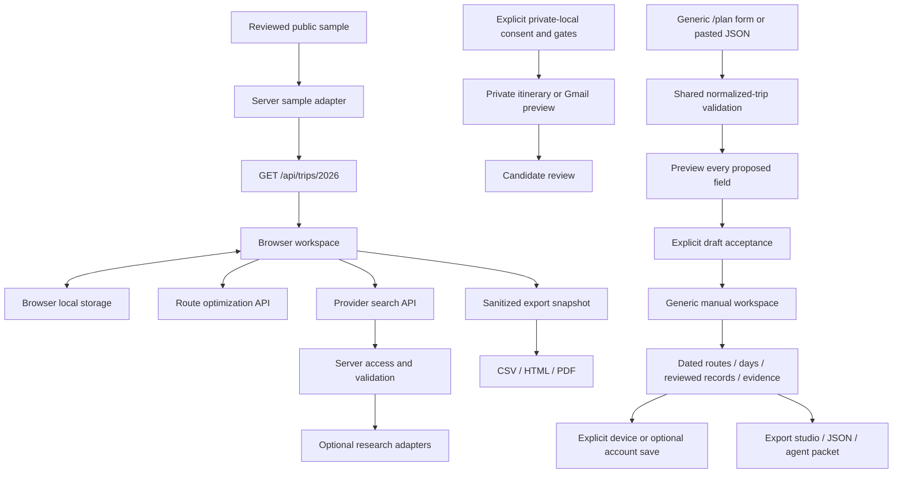

# Architecture

TRIPPY is a Next.js application with a detailed sample atlas, a generic trip-draft workflow, optional server-side research adapters, optional live activity/day rooms, and an explicitly separated private import boundary. The primary atlas loads the reviewed Europe 2026 sample. `/plan` previews normalized input for arbitrary cities and dates, then opens a separate manual workspace with dated route allocations, day/activity editing, explicit coordinates, reviewed records and evidence. An agent handoff remains available. `/collaborate` edits a separate share-safe planning board using hashed role capabilities and durable SQLite/Postgres revision checks. The specialized atlas remains a separate compatibility surface. Optional private accounts already provide explicit encrypted workspace save/load on user-owned storage; production hosting and real recovery delivery remain unverified. See [module boundaries and migration plan](MODULARITY.md) and [live collaboration](LIVE_COLLABORATION.md).

## Runtime today

`src/app/page.tsx` mounts `src/components/trip-workspace.tsx`. The workspace fetches the sample API, composes planning views, and saves selections and assignments to local storage. `src/lib/current-trip.ts` adapts the older compact sample format into the typed view payload in `src/lib/trip-model.ts`. It also joins reviewed corrections, map coordinates, and hotel enrichment. The legacy 2025 view has a separate data path.

`src/app/plan/page.tsx` mounts `src/components/new-trip-planner.tsx`. Its draft stays in browser memory and clears on reload. Shared logic in `src/lib/normalized-trip.ts` creates drafts, validates the actual JSON Schema plus relationships and private-text checks, and generates the agent brief. Preview does not replace an accepted draft. Acceptance opens `src/components/generic-trip-workspace.tsx`; planning JSON and an agent brief remain available. Workspace edits do not invoke providers or infer bookings. Browser save and optional account upload are separate explicit actions, and neither writes the sample atlas.

The same shared validation powers `npm run trip:init`, `npm run trip:validate`, and the release gate's `schema:check`. Initialization writes a new normalized draft beneath the private-local trip directory and refuses an existing destination. The CLI is a local authoring tool, not a server filesystem endpoint.

The optional account module has tenant-qualified, revision-checked encrypted workspace writes behind Better Auth sessions; it is disabled until configured. Capability-based collaboration rooms separately persist share-safe activity/day boards. Neither surface silently synchronizes the sample atlas, browser state or generic workspace. Hosting alone does not configure accounts, backups or room storage. [Deployment modes](DEPLOYMENT_MODES.md) describes that boundary.

## Code boundaries

| Concern | Source home | Contract |
| --- | --- | --- |
| App shell and API handlers | `src/app/` | HTTP request validation, authorization, bounded responses, cache policy |
| Planning presentation | `src/components/` | Props and local interaction; no provider credentials |
| Generic intake and agent handoff | `src/components/new-trip-planner.tsx`, `src/lib/normalized-trip.ts`, `schema/trip.schema.json` | Browser-memory preview/accept; actual schema, relationships and privacy validation |
| Generic manual planning | `src/lib/generic-trip-workspace.ts`, `src/lib/planning-view.ts`, `src/components/planning-tools.tsx` | Optional evidence/allocation sidecars, dated allocation preview, current receipts, readiness and agent packet; validated browser/account/export paths |
| Private accounts | `src/lib/accounts/`, account API and controls | Explicit encrypted tenant-owned workspace persistence; disabled by default |
| Sample compatibility adapter | `src/lib/current-trip.ts`, reviewed enrichment modules | Translate reviewed sample data into a view payload; isolate legacy keys |
| Typed view records | `src/lib/trip-model.ts` | Stops, activities, stays, transport, days, and booking summaries |
| Route decisions | `src/lib/optimization/route-optimizer.ts` | Structured stops, candidate legs, explicit weights, uncertainty and explanations |
| Logistics | `src/lib/trip-logistics.ts` | Derive planning gaps and timeline from records; preserve confirmation semantics |
| Research providers | `src/lib/providers/` | Optional typed research results with source, freshness, limitations and failure state |
| Agent update interchange | `src/lib/trippy-bundle.ts`, `schema/trippy-update.schema.json` | Bounded, parsed, previewed changes against an existing workspace scope |
| Exports | `src/lib/trip-exports.ts`, HTML/PDF modules, export API | Build and sanitize a selected snapshot before rendering files |
| Private access and imports | `src/lib/private-access.ts`, `src/lib/private-itinerary.ts`, `src/lib/imports/gmail/` | Explicit local/private consent, read-only candidates, raw input custody |
| Public release checks | `scripts/`, `.github/workflows/ci.yml` | Current artifacts and reachable history; no secret-dependent verification |

The generic normalized trip schema in `schema/trip.schema.json` and its city-break example drive the new draft workflow and CLI. They remain distinct from the older compact Europe sample and the current `Trip2026Payload`. A schema-valid new draft does not yet become a selectable detailed atlas workspace automatically. Do not describe these formats as interchangeable without an explicit view adapter.

Shared validation checks unique IDs, date-window bounds, night constraints, known route/anchor references, required cities and locked-anchor destination retention. Canonical route candidates record city order; optional workspace `routeAllocations` add whole-night allocations. The planning view derives dates and rejects incomplete allocations and fixed-anchor/minimum/maximum-night conflicts before an explicit day-destination preview. Applying it preserves activity and booking dates. It does not prove schedules, transit slack or inventory.

## Provider boundary

`ProviderAdapter` in `src/lib/providers/types.ts` specifies `configured`, `health`, `supports`, and `search`. A search returns normalized results and freshness, or a typed failure. The composition root in `src/lib/providers/index.ts` constructs adapters server-side; request parsing, access checks, and HTTP handling remain outside presentation components.

Implemented adapters cover SerpApi cash flights, hotels, places and general research; Seats.aero award flights and Rooms.aero award hotels; and Booking.com Demand hotel research for eligible accounts. Manual provider handoffs preserve useful zero-key behavior. The Connections UI uses `src/lib/provider-search-controls.ts` to initialize supported profile fields, validate requests and sort returned cash/time evidence. Currency, cabin, award seats/program and stay dates remain editable or unknown rather than inheriting sample assumptions. Capability/control changes cancel stale requests. A compiled adapter or configured key does not prove current inventory, eligibility, complete coverage or booking ability.

Credentials remain in untracked local configuration or a server secret manager. Production live quota uses the signed-session access boundary. Private itinerary-file adapters are disabled in production. Host-local MCPs belong to the agent host and are not installed into or reachable through a deployed Next.js app merely because its documentation names them.

## Data, review, and privacy

The product contract uses `recommended`, `quoted`, `held`, `confirmed`, `missing`, and `conflict` booking states. A recommendation, quote, parsed email, or optimization result cannot create a confirmation. Existing compatibility types still contain older labels such as `tbc`; the schema and migration work described in [MODULARITY.md](MODULARITY.md) must reconcile those labels explicitly rather than silently promoting their state.

Gmail preview is an optional private read-only research path. Raw messages, provider payloads, OAuth material, links and booking identifiers must remain outside public samples and exports. Import candidates require explicit review before a normalized write or state transition. A durable review/approve/reject ledger is not currently implemented.

The shared export studio (`src/components/export-studio.tsx`, `src/lib/export-preview.ts`) validates the complete current snapshot before scope selection, then previews a reading copy in a sandbox. Linked images require explicit preview opt-in. Atlas export is a separate sanitization step with its own tests. It is not the full private object rendered in a different theme. Legacy `private-operational` callers now receive redacted downloadable artifacts too; the UI no longer offers a private identifier-bearing download. The generic planning JSON download and agent brief require a validated, accepted planning draft; they are a separate interchange path from atlas CSV/HTML/PDF. Public samples must be built through the sanctioned sample transform, scanned, and independently reviewed. Browser local storage is still user data: it is not appropriate for multi-user authorization, secret custody, or durable retention guarantees.

## Presentation and resilience

Maps are optional presentation. Routes, dates and lists remain visible when tiles, geocoding, images, or providers fail. Hotel and activity pin toggles change map density without changing selections. Research and optimization views retain manual, unavailable, partial and stale states rather than inventing availability or price certainty.

UI controls should work by keyboard and on small screens, with textual status and non-color-only distinctions. The current quality gate covers lint, types, tests, sample checks, production compilation and privacy/history scans; it must be accompanied by a representative browser planning flow. A build alone does not verify accessibility or live provider coverage.

## Extension rules

Keep route-specific dates, city aliases, imagery, airport defaults and booking narrative in reviewed data packs or the compatibility adapter. Keep the optimizer and provider contracts free of sample city assumptions. Add tests with invented destinations and missing data before expanding the product claims. [MODULARITY.md](MODULARITY.md) records the existing coupling and acceptance criteria for that migration.

Generic item receipts retain source/time/unknowns and become `reviewRequired` when their supported entity changes. Optional `itemEvidence`, `routeAllocations`, `researchEvidence`, `quoteEvidence` and `budgetQuoteIds` remain workspace fields, not additions to the normalized trip schema. See [current verification limits](IMPLEMENTATION_STATUS.md#remaining-verification-and-product-gaps).

Selected quote budgeting uses [`src/lib/trip-budget.ts`](../src/lib/trip-budget.ts) and [`src/components/trip-budget.tsx`](../src/components/trip-budget.tsx). It sums explicit recorded party totals by currency, keeps source programs separate and reports unknowns/overlaps; it does not select quotes or prove complete trip cost.
