# Trippy photo gallery

The complete set of 156 bundled travel photographs used by the reviewed sample. The captions below identify associated planning catalogue entries, not an independently verified photographic description or author credit.

The owner has confirmed that the existing photo licenses are acquired; license records and required per-photo attributions are deferred. These images are not covered by the MIT code license. See [media provenance](MEDIA.md) before reuse or adding images.

[Back to the README](../README.md) · Explore the interactive sample atlas locally at `/` and the introduction at `/about`.

<table>
<tr>
<td width="33%">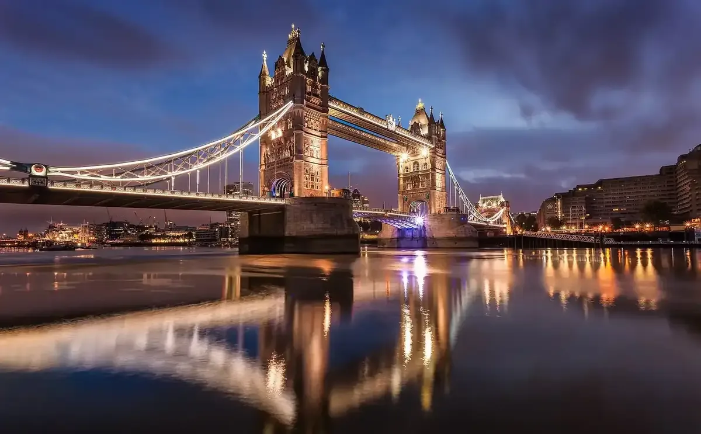 Guide photograph</td>
<td width="33%">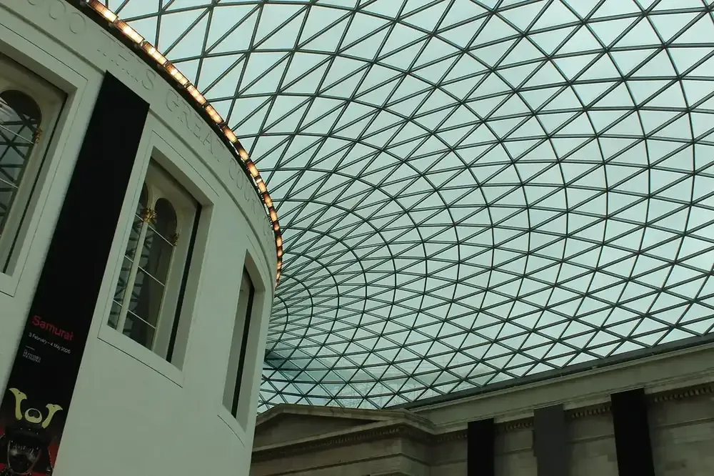 London · The British Museum</td>
<td width="33%"> London · Westminster &amp; Whitehall</td>
</tr>
<tr>
<td width="33%">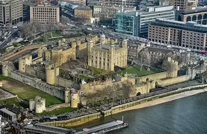 London · Tower of London</td>
<td width="33%">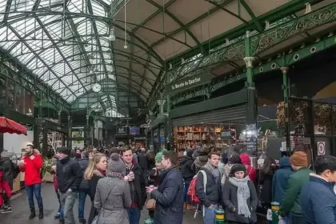 London · Borough Market</td>
<td width="33%">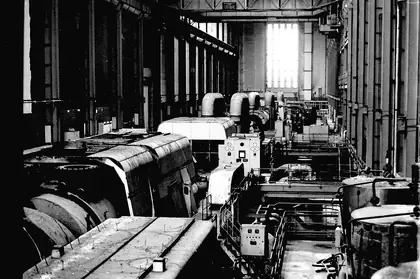 London · Tate Modern &amp; the South Bank</td>
</tr>
<tr>
<td width="33%">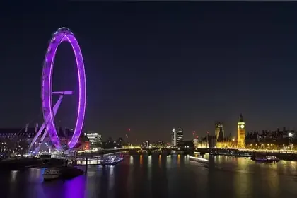 London · Thames at dusk</td>
<td width="33%">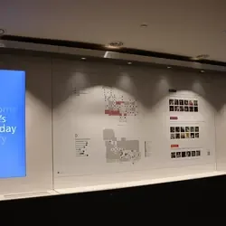 London · National Gallery</td>
<td width="33%">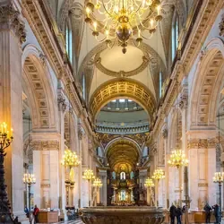 London · St Paul&#x27;s Cathedral</td>
</tr>
<tr>
<td width="33%">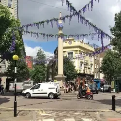 London · Covent Garden &amp; Seven Dials</td>
<td width="33%">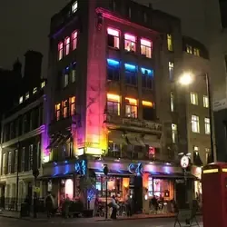 London · Soho after dark</td>
<td width="33%">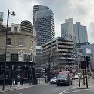 London · Shoreditch &amp; Brick Lane</td>
</tr>
<tr>
<td width="33%">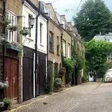 London · Notting Hill &amp; Portobello</td>
<td width="33%">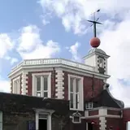 London · Greenwich &amp; Royal Observatory</td>
<td width="33%">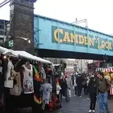 London · Camden Market</td>
</tr>
<tr>
<td width="33%">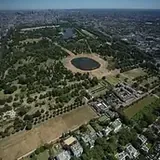 London · Hyde Park &amp; Kensington Gardens</td>
<td width="33%">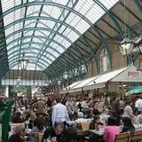 London · A West End show</td>
<td width="33%">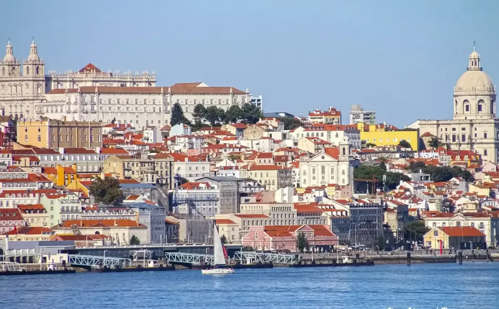 Guide photograph</td>
</tr>
<tr>
<td width="33%">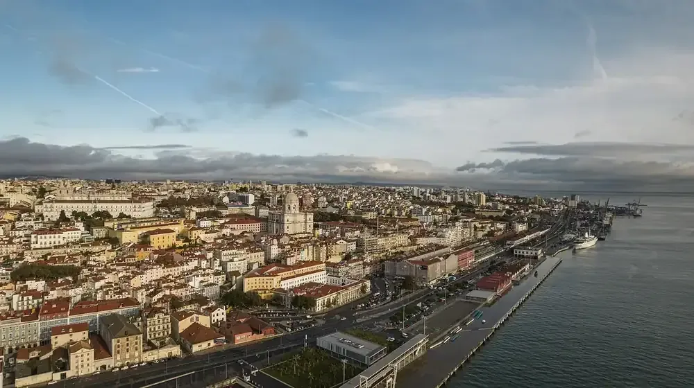 Lisbon · Alfama, on foot, with no plan</td>
<td width="33%">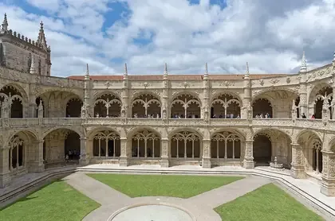 Lisbon · Jerónimos Monastery</td>
<td width="33%"> Lisbon · Belém Tower</td>
</tr>
<tr>
<td width="33%">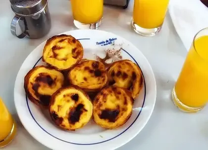 Lisbon · Pastéis de Belém</td>
<td width="33%">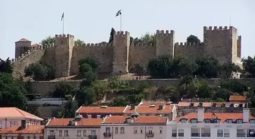 Lisbon · São Jorge Castle</td>
<td width="33%">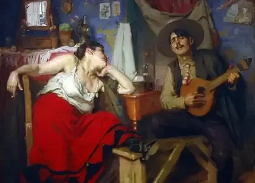 Lisbon · Fado in a small room</td>
</tr>
<tr>
<td width="33%">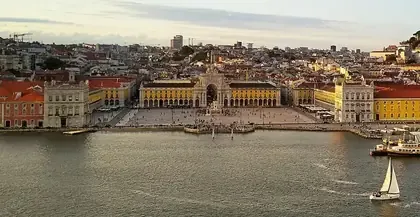 Lisbon · Praça do Comércio &amp; Baixa</td>
<td width="33%">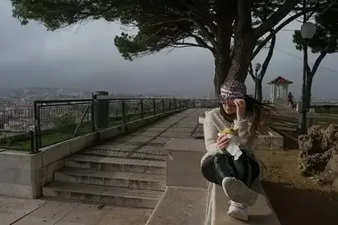 Lisbon · The miradouro circuit</td>
<td width="33%">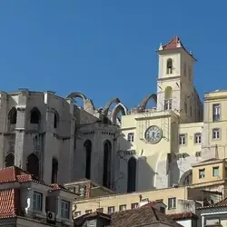 Lisbon · Carmo Convent</td>
</tr>
<tr>
<td width="33%">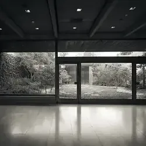 Lisbon · Gulbenkian Museum</td>
<td width="33%">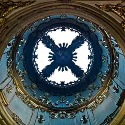 Lisbon · National Tile Museum</td>
<td width="33%">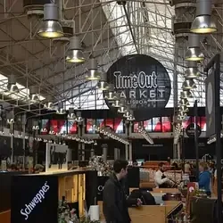 Lisbon · Time Out Market</td>
</tr>
<tr>
<td width="33%">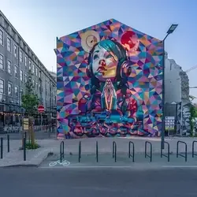 Lisbon · LX Factory</td>
<td width="33%"> Lisbon · Padrão dos Descobrimentos</td>
<td width="33%"> Lisbon · Cais do Sodré &amp; Pink Street</td>
</tr>
<tr>
<td width="33%">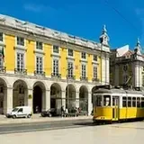 Lisbon · Tram 28</td>
<td width="33%">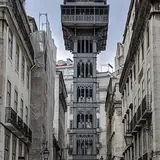 Lisbon · Santa Justa Lift</td>
<td width="33%">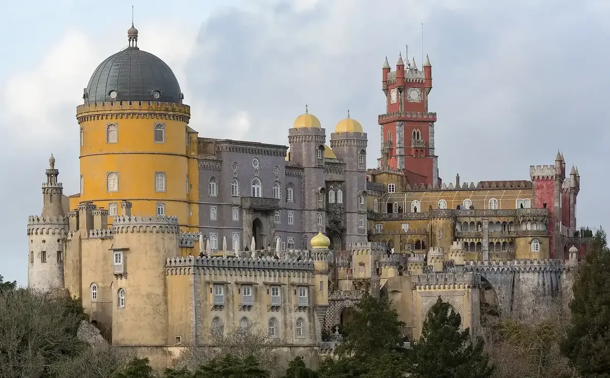 Guide photograph</td>
</tr>
<tr>
<td width="33%">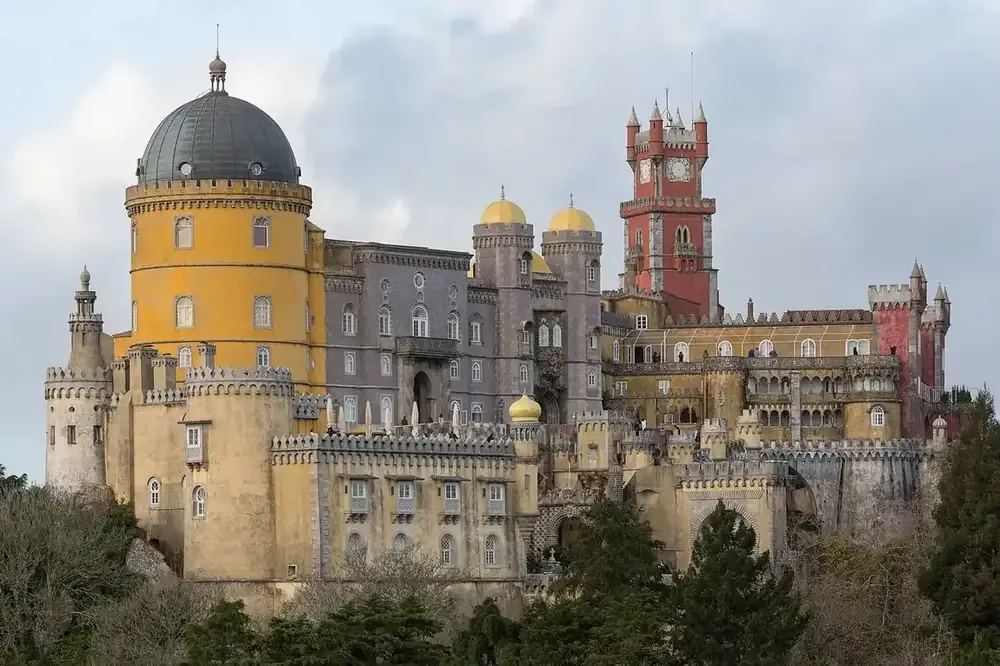 Sintra · Pena Palace &amp; Park</td>
<td width="33%">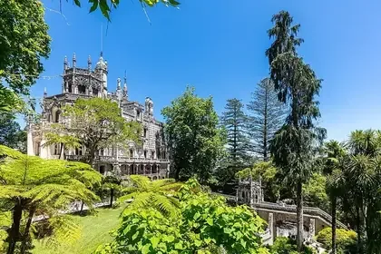 Sintra · Quinta da Regaleira</td>
<td width="33%">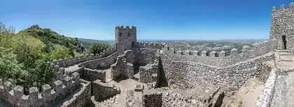 Sintra · Castle of the Moors</td>
</tr>
<tr>
<td width="33%">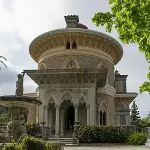 Sintra · Monserrate Palace</td>
<td width="33%"> Sintra · Sintra National Palace</td>
<td width="33%"> Sintra · Cabo da Roca &amp; Cascais</td>
</tr>
<tr>
<td width="33%">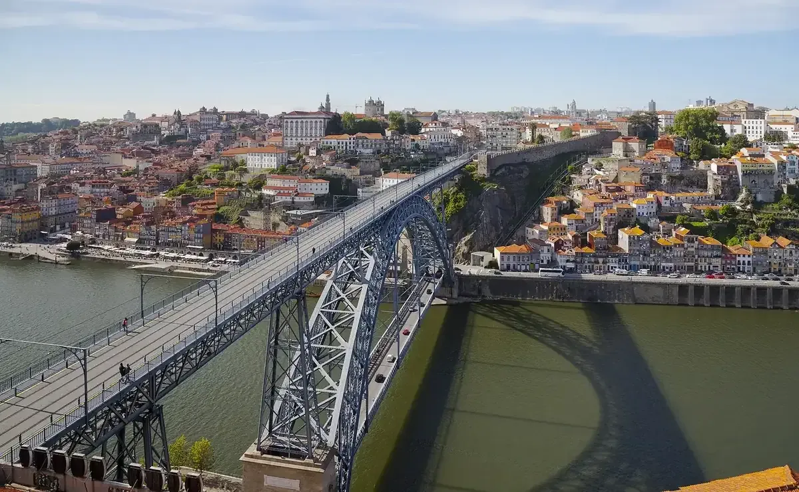 Guide photograph</td>
<td width="33%">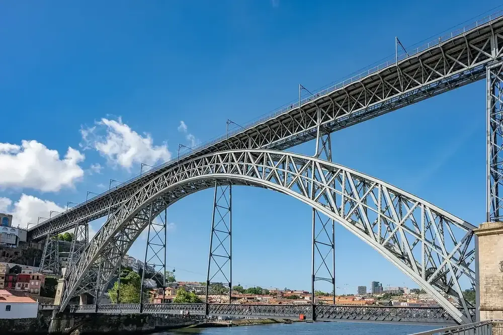 Porto · Ribeira &amp; the Dom Luís I Bridge</td>
<td width="33%">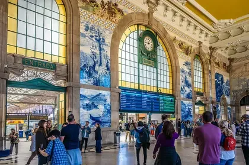 Porto · São Bento Station</td>
</tr>
<tr>
<td width="33%">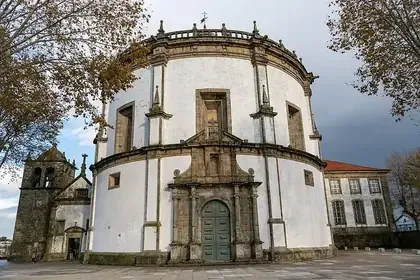 Porto · A port lodge in Gaia</td>
<td width="33%">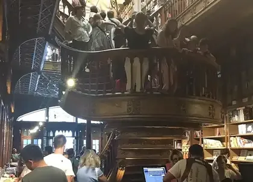 Porto · Livraria Lello</td>
<td width="33%">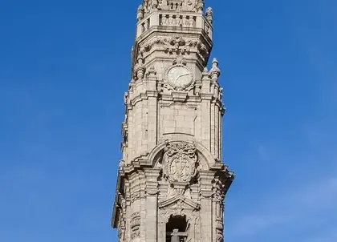 Porto · Clérigos Tower</td>
</tr>
<tr>
<td width="33%">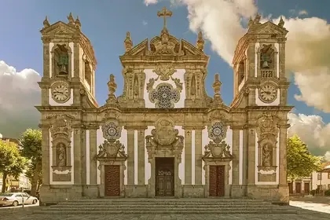 Porto · Matosinhos seafood lunch</td>
<td width="33%">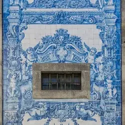 Porto · Capela das Almas</td>
<td width="33%">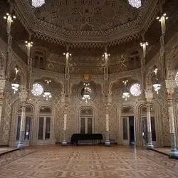 Porto · Palácio da Bolsa</td>
</tr>
<tr>
<td width="33%">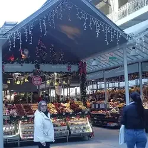 Porto · Mercado do Bolhão</td>
<td width="33%">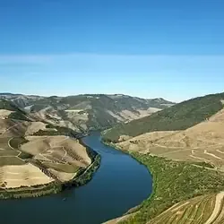 Porto · Douro Valley</td>
<td width="33%"> Porto · Foz do Douro</td>
</tr>
<tr>
<td width="33%"> Porto · Six Bridges cruise</td>
<td width="33%"> Porto · Serralves</td>
<td width="33%">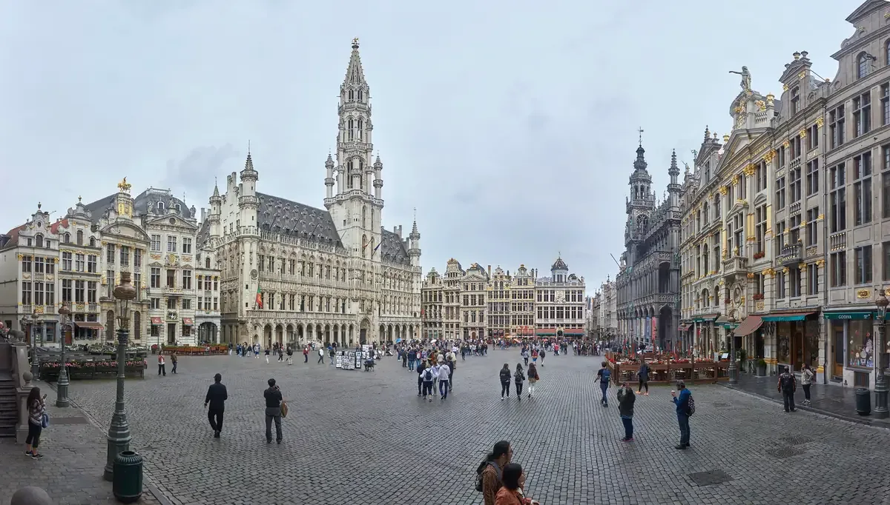 Guide photograph</td>
</tr>
<tr>
<td width="33%">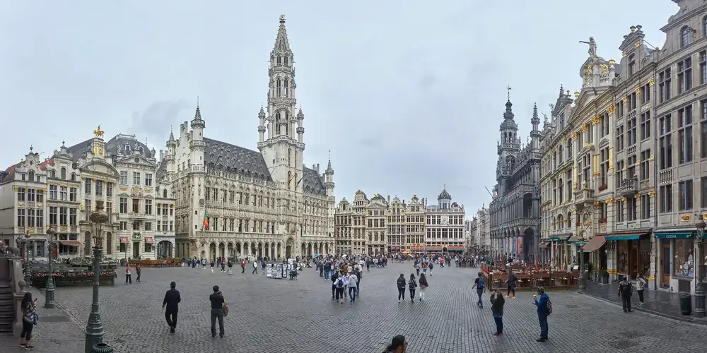 Brussels · Grand Place, lit up at night</td>
<td width="33%">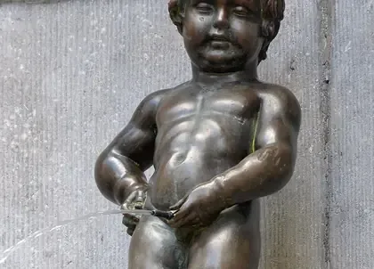 Brussels · Manneken Pis</td>
<td width="33%"> Brussels · Galeries Royales Saint-Hubert</td>
</tr>
<tr>
<td width="33%"> Brussels · Cathedral of St Michael and St Gudula</td>
<td width="33%"> Brussels · Mont des Arts</td>
<td width="33%"> Brussels · Magritte Museum</td>
</tr>
<tr>
<td width="33%"> Brussels · Belgian waffles, fries and chocolate</td>
<td width="33%"> Brussels · Grand Sablon</td>
<td width="33%"> Brussels · Ghent, day trip</td>
</tr>
<tr>
<td width="33%"> Brussels · Atomium &amp; Mini-Europe</td>
<td width="33%"> Brussels · Belgian Comic Strip Center</td>
<td width="33%"> Brussels · Parc du Cinquantenaire</td>
</tr>
<tr>
<td width="33%"> Brussels · BELvue Museum &amp; Coudenberg</td>
<td width="33%"> Brussels · Horta Museum</td>
<td width="33%"> Brussels · Marolles flea market</td>
</tr>
<tr>
<td width="33%"> Brussels · Belgian Beer World</td>
<td width="33%"> Brussels · Parlamentarium &amp; the EU quarter</td>
<td width="33%"> Brussels · Bruges, day trip</td>
</tr>
<tr>
<td width="33%"> Guide photograph</td>
<td width="33%"> Bruges · The Rozenhoedkaai and the canals</td>
<td width="33%"> Bruges · Belfry of Bruges</td>
</tr>
<tr>
<td width="33%"> Bruges · A canal boat</td>
<td width="33%"> Bruges · Basilica of the Holy Blood</td>
<td width="33%"> Bruges · Groeningemuseum</td>
</tr>
<tr>
<td width="33%"> Bruges · Begijnhof Ten Wijngaerde</td>
<td width="33%"> Bruges · Minnewater</td>
<td width="33%"> Guide photograph</td>
</tr>
<tr>
<td width="33%"> Amsterdam · The canal belt after dark</td>
<td width="33%"> Amsterdam · Rijksmuseum</td>
<td width="33%"> Amsterdam · Van Gogh Museum</td>
</tr>
<tr>
<td width="33%"> Amsterdam · Anne Frank House</td>
<td width="33%"> Amsterdam · A bike, and the whole city</td>
<td width="33%"> Amsterdam · De Pijp &amp; Albert Cuyp Market</td>
</tr>
<tr>
<td width="33%"> Amsterdam · Amsterdam Noord &amp; NDSM</td>
<td width="33%"> Amsterdam · The Nine Streets</td>
<td width="33%"> Amsterdam · Begijnhof</td>
</tr>
<tr>
<td width="33%"> Amsterdam · Museumplein</td>
<td width="33%"> Amsterdam · Rembrandt House Museum</td>
<td width="33%"> Amsterdam · De Wallen</td>
</tr>
<tr>
<td width="33%"> Amsterdam · Zaanse Schans</td>
<td width="33%"> Amsterdam · Haarlem or Utrecht</td>
<td width="33%"> Guide photograph</td>
</tr>
<tr>
<td width="33%"> Berlin · The Reichstag dome</td>
<td width="33%"> Berlin · Brandenburg Gate &amp; Tiergarten</td>
<td width="33%"> Berlin · Memorial to the Murdered Jews of Europe</td>
</tr>
<tr>
<td width="33%"> Berlin · Berlin Wall Memorial, Bernauer Straße</td>
<td width="33%"> Berlin · Topography of Terror</td>
<td width="33%"> Berlin · Neues Museum</td>
</tr>
<tr>
<td width="33%"> Berlin · East Side Gallery</td>
<td width="33%"> Berlin · Museum Island</td>
<td width="33%"> Berlin · Gemäldegalerie</td>
</tr>
<tr>
<td width="33%"> Berlin · Kreuzberg &amp; Neukölln</td>
<td width="33%"> Berlin · Tempelhofer Feld</td>
<td width="33%"> Berlin · Potsdam &amp; Sanssouci</td>
</tr>
<tr>
<td width="33%"> Berlin · A night out</td>
<td width="33%"> Berlin · Fernsehturm</td>
<td width="33%"> Berlin · Berlin Cathedral &amp; Lustgarten</td>
</tr>
<tr>
<td width="33%"> Berlin · Sachsenhausen Memorial</td>
<td width="33%"> Berlin · Mauerpark flea market</td>
<td width="33%"> Guide photograph</td>
</tr>
<tr>
<td width="33%"> Munich · Oktoberfest at the Theresienwiese</td>
<td width="33%"> Munich · Marienplatz and the Glockenspiel</td>
<td width="33%"> Munich · Viktualienmarkt</td>
</tr>
<tr>
<td width="33%"> Munich · Englischer Garten</td>
<td width="33%"> Munich · Surfers on the Eisbach</td>
<td width="33%"> Munich · Hofbräuhaus</td>
</tr>
<tr>
<td width="33%"> Munich · Munich Residenz</td>
<td width="33%"> Munich · Neuschwanstein</td>
<td width="33%"> Munich · Dachau Memorial</td>
</tr>
<tr>
<td width="33%"> Munich · BMW Welt &amp; Museum</td>
<td width="33%"> Munich · Nymphenburg Palace</td>
<td width="33%"> Munich · Asamkirche</td>
</tr>
<tr>
<td width="33%"> Munich · Olympiapark</td>
<td width="33%"> Munich · Deutsches Museum</td>
<td width="33%"> Guide photograph</td>
</tr>
<tr>
<td width="33%"> Ring · A lap of the Nordschleife</td>
<td width="33%"> Ring · The Grand Prix circuit</td>
<td width="33%"> Ring · Adenau</td>
</tr>
<tr>
<td width="33%"> Ring · Nürburg Castle</td>
</tr>
</table>

Originals, source documents and private review sheets are excluded from Git. Public image bytes and hashes are listed in [the media manifest](../public/media-manifest.json).

<tr>
<td width="33%"> Nürburgring · Rent a car built for it — not your rental</td>
<td width="33%"> Nürburgring · Watch from Brünnchen</td>
<td width="33%"> Egypt · Starlight Festival at the Pyramids</td>
</tr>

<tr>
<td width="33%"> Egypt · The Giza plateau</td>
<td width="33%"> Egypt · The Great Sphinx</td>
<td width="33%"> Egypt · Grand Egyptian Museum</td>
</tr>

<tr>
<td width="33%"> Egypt · Islamic Cairo &amp; Al-Muizz Street</td>
<td width="33%"> Egypt · Khan el-Khalili</td>
<td width="33%"> Egypt · Saqqara &amp; the Step Pyramid</td>
</tr>

<tr>
<td width="33%"> Egypt · Mosque of Muhammad Ali &amp; the Citadel</td>
<td width="33%"> Egypt · Mosque of Ibn Tulun</td>
<td width="33%"> Egypt · Sultan Hassan &amp; Al-Rifa'i</td>
</tr>

<tr>
<td width="33%"> Egypt · Coptic Cairo</td>
<td width="33%"> Egypt · Dahshur</td>
<td width="33%"> Egypt · Egyptian Museum, Tahrir</td>
</tr>

<tr>
<td width="33%"> Egypt · Felucca on the Nile at sunset</td>
<td width="33%"> Egypt · Al-Azhar Mosque &amp; Park</td>
<td width="33%"> Egypt · Zamalek</td>
</tr>

<tr>
<td width="33%"> Egypt · Cairo Tower</td>
<td width="33%"> Egypt · Memphis &amp; Mit Rahina</td>
</tr>
</table>
