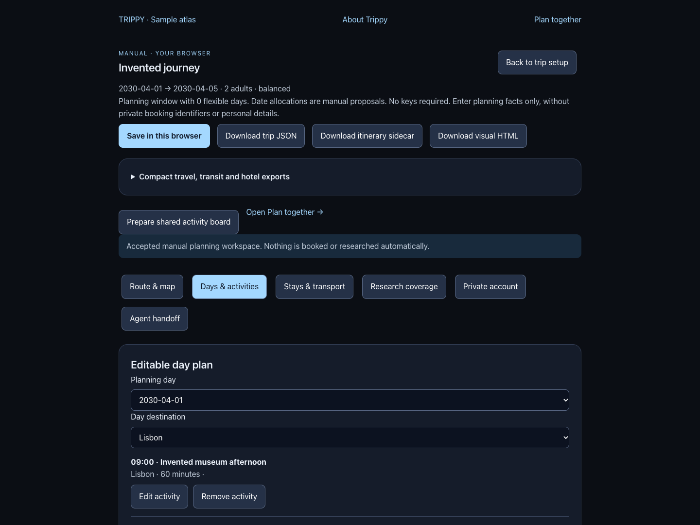
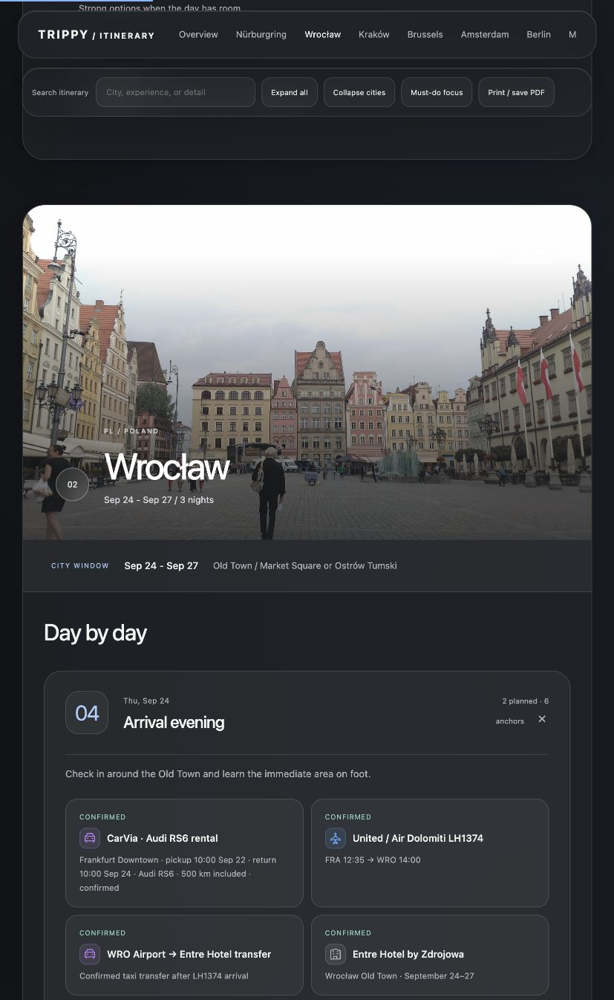
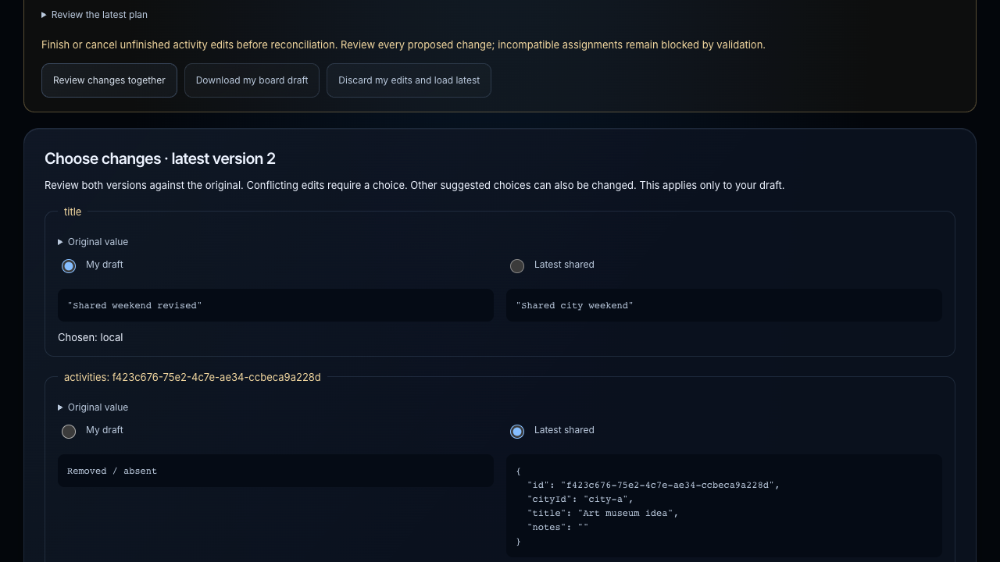
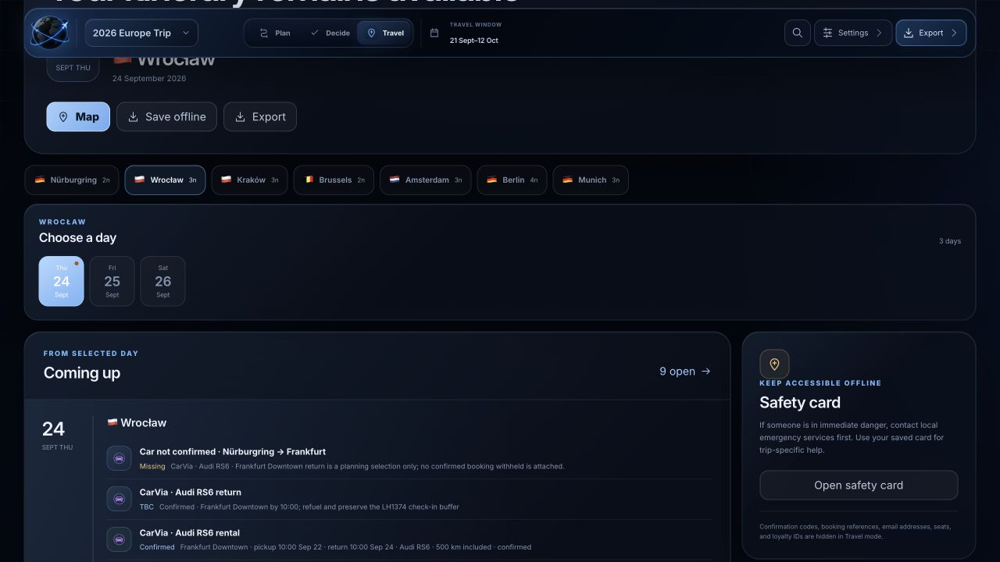
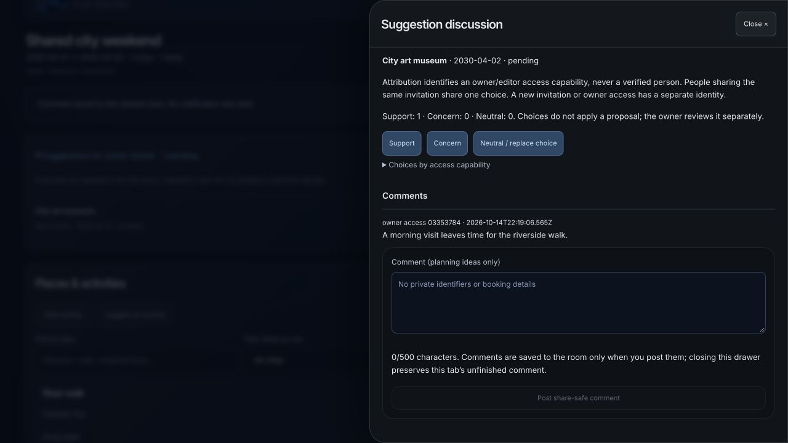
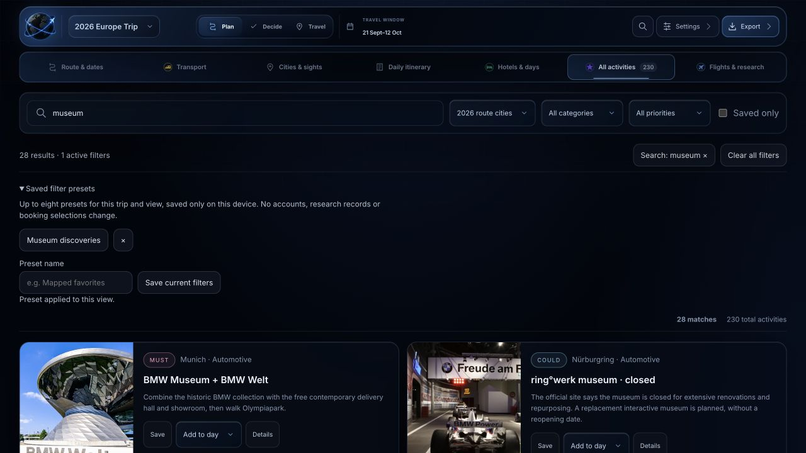
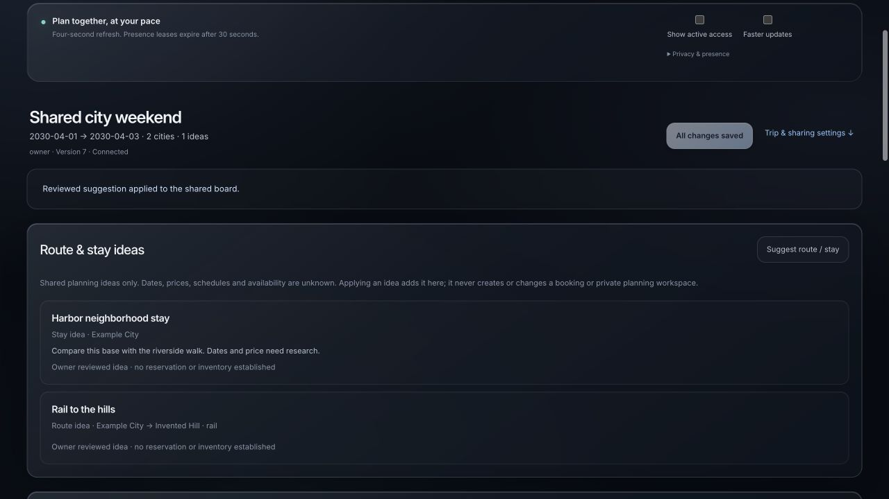
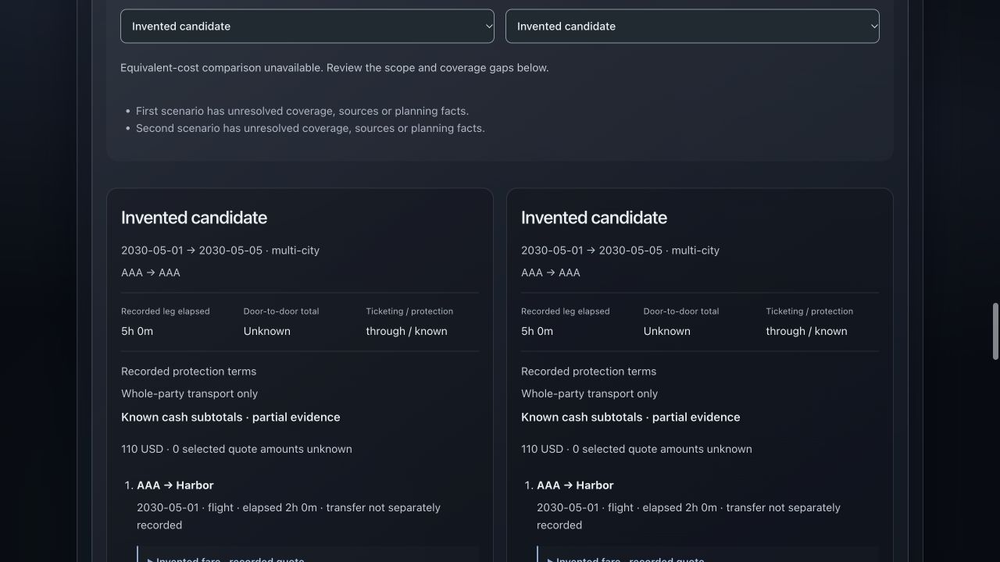
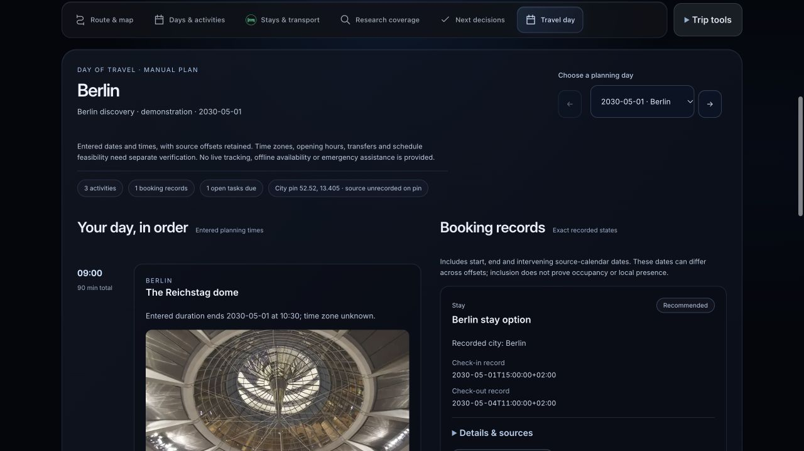
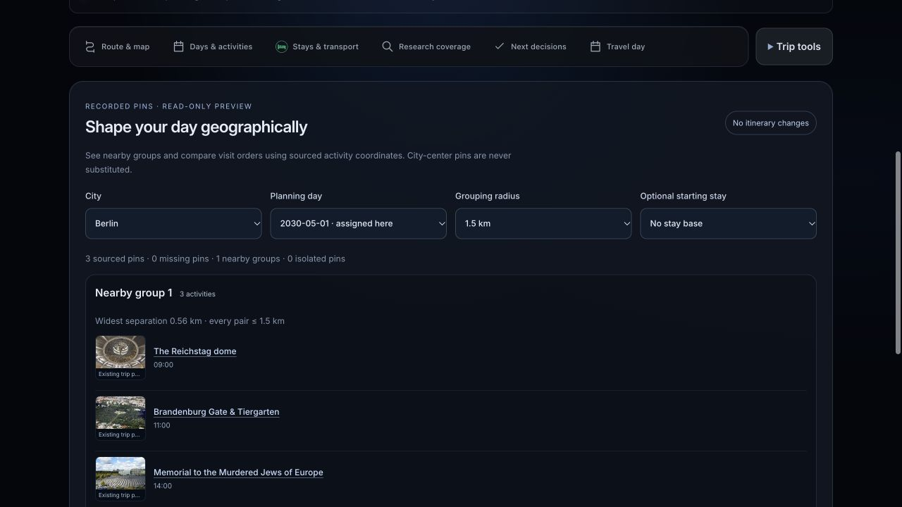

# Trippy app screenshots

The gallery contains **37 screenshots** from actual app surfaces. The latest production-candidate refresh replaces collaboration, export studio, preparation and shared history with the atlas navy glass design and recorded activity photography. It adds the generic Travel day and nearby-place grouping views. These six captures use invented Berlin/Munich planning records with reviewed public sample photos; current board photography is separate from revision history.

Other captures retain their reviewed earlier versions. Screenshots demonstrate the stated views, not every roadmap feature or hosted/provider acceptance. No real contacts, booking identifiers, credentials or invitation capabilities appear.

[Back to the README](../README.md) · [Travel photo gallery](PHOTO_GALLERY.md)

Screenshots are lossless WebP derivatives with embedded metadata removed. The route view depicts the European route with flight, rail and driving layers. City maps show only places with available coordinates; unknown locations are not invented. Historical rates, saved booking states and the Travel mode date are sample evidence, not current provider checks. The rich atlas and shared planning board remain separate as explained in [current capabilities](IMPLEMENTATION_STATUS.md).

The app UI is MIT licensed. Depicted photos keep their separate licenses. City-map attributions remain visible in the captures: OpenFreeMap, OpenMapTiles and OpenStreetMap. The overview uses repository route artwork and Natural Earth country data. See [media provenance](MEDIA.md).

## Overall route: flight, rail, driving and booking gaps

## Nürburgring places map

## Wrocław places map

## Kraków places map

## Brussels places map

## Amsterdam places map

## Berlin places map

## Munich places map

## Hotel and location comparison

## Daily itinerary builder and logistics map

## Route research and optimization

## Transport alternatives

## Activity catalogue

## Decide mode: unresolved decisions and evidence

## Travel mode: day-by-day tools

## New trip draft and agent brief

## Shared planning room setup

## Itinerary editor: scheduled cards and day controls

## Collaborative editor: shared catalogue, days and invitation management

These editor and invitation views were added after the production-origin fix. Owner access and creation-code values are absent from the screenshots.

## Owner controls: invitations and revocation

## Generic manual workspace: your cities and editable days

This is the separate arbitrary-trip workspace, not a renamed sample atlas. Dates, places, activities, maps from supplied coordinates and booking/evidence records remain manually reviewed; no live inventory or geocoding is implied.

## Visual export: a current itinerary reading copy

The reading export preserves current entered days, activities, alternatives and recorded states. It is not a provider confirmation. Compact travel/transit/hotel HTML/PDF, existing atlas light/dark/visual modes and CSV remain available. [Formats and offline limits](EXPORTS.md).

## Shared-board reconciliation: review both versions

The review compares the base, local draft and latest shared revision. Choices apply to a validated local draft before a separate conditional save; conflicting references or another revision pause the flow. [Live collaboration](LIVE_COLLABORATION.md).

## Flight cash and points comparison

Illustrative manual inputs in the working comparison panel, not provider quotes.

## Multimodal transport alternatives

## Daily travel logistics

## Compact hotel stay rows

## Photographic itinerary cover

Transport hues are blue for flights, yellow for rail and purple for driving; status remains a separate label or dash pattern. Invented generic plans contain no traveler identifiers.

The 2026-10-14 visual pass refreshed the route mode colors, itinerary editor, trip setup, generic workspace, collaboration layout, hotels and dossier chapters. Reconciliation and invitation screenshots retain their earlier functional snapshots; their current surfaces use the shared charcoal/glass styles.

## Export studio

Side-by-side settings and sandboxed reading preview, captured from the current candidate with reviewed public sample photos. Local preview embeddings are opt-in and bounded; counts do not promise a complete offline download.

## Proposal discussion

Invented local room, owner access pseudonym and synthetic planning comment. No invitation value, real contact or private trip record appears. The refreshed hotel rows and these two captures were pixel-reviewed on 2026-10-14; other historical captures retain the versions described above.

## Tasks, packing and reviewed alternatives

An invented trip with a completed packing task and a same-city fallback pair. Role aliases are not verified identities; source and suitability unknowns remain explicit.

## Shared revision history

An invented local SQLite room with invitation and board summaries. The displayed access alias is a pseudonym, not an invitation capability. The latest-100 window contains categories/counts rather than private content.

## Saved catalogue filters

## Reviewed shared stay ideas

## Recorded journey evidence

These three captures were added from the current production candidate. Shared ideas do not establish bookings. Journey comparisons show entered demonstration evidence, not live inventory or real available fares.

## Travel day: agenda, recorded bookings and preparation

## Nearby places: sourced pins and read-only grouping

